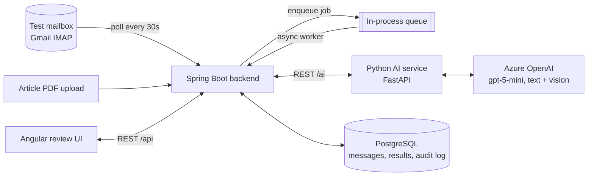

# Smart Inbox Assistant

A working prototype that reads a healthcare company's shared mailbox, understands each email and its
PDF attachments, sorts every message into **Safety Report (ICSR)**, **Quality Complaint (PQC)**,
**Info Request (MI)** or **Not Relevant**, pulls out the key facts with a link back to where each fact
came from, and puts everything on a review screen where a human accepts or corrects the AI's work.

Built for the Clinevo Technologies "Smart Inbox Assistant" take-home assignment.
[`docs/write-up.md`](docs/write-up.md) covers the architecture, tech choices, prompting approach,
batch results, bugs found during testing and known limitations in depth.

> **All data in this repository is synthetic.** The patients, reporters and products (Neptazol,
> Ferbolex, Cortivex Cream, Sedaprin, Glucoreg) are invented. Never send real patient data to the
> test mailbox or the app.

---

## Contents

- [How it works](#how-it-works)
- [Tech stack](#tech-stack)
- [Quick start](#quick-start)
- [Using the app](#using-the-app)
- [Getting mail into the app](#getting-mail-into-the-app)
- [Bonus: literature screening](#bonus-literature-screening)
- [Assignment coverage](#assignment-coverage)
- [Environment variables](#environment-variables)
- [REST API](#rest-api)
- [Troubleshooting](#troubleshooting)
- [Local development without Docker](#local-development-without-docker)
- [Project layout](#project-layout)
- [Known limitations](#known-limitations)
- [Data handling](#data-handling)

---

## How it works



1. **Intake.** The backend polls the test mailbox over IMAP. Each new email is parsed (sender,
   subject, date, body, PDF attachments) and saved, then a processing job is put on a queue, so
   the screen never waits on the AI.
2. **PDF understanding.** For each PDF, the AI service works out which of the four types it is and
   handles it accordingly:

   | PDF type | How it is detected | What happens |
   |---|---|---|
   | Digital | Has a text layer, English, not article-like | Text extracted directly |
   | Scanned / handwritten | Almost no text layer | Each page is read by the vision model, with a confidence score |
   | Published article | Article keywords or a multi-column layout | Only the patient-case passages are kept; references and discussion are dropped |
   | Non-English | Language detection on the text | Translated to English for analysis; the original PDF stays viewable |

   For every PDF it also extracts tables as rows and columns, describes meaningful images and flags
   them for review, and writes a reviewer summary saying whether the document looks relevant and why.
3. **Classification and extraction.** A single structured LLM call assigns one or more categories
   (each with a confidence and a one-line reason) and extracts the category's fields. Anything not
   in the source is set to `"Not stated"`. Every field records whether it came from the email body
   or a specific PDF page.
4. **Review.** The reviewer sees the email, each PDF (with an embedded viewer, tables and images),
   the AI's categories and fields, and can accept, reject or override each one. Every AI decision
   and every reviewer action is written to a timestamped audit log.

## Tech stack

| Layer | Technology | Notes |
|---|---|---|
| Frontend | Angular 18 + Angular Material | Review queue, document viewer, editable fields |
| Backend API | Spring Boot 3.3 (Java 21) | REST API, IMAP intake, queue, persistence, audit |
| AI service | Python 3.12 + FastAPI | PyMuPDF, pdfplumber, langdetect, OpenAI SDK |
| AI model | Azure OpenAI `gpt-5-mini` | One multimodal reasoning model for text and vision (OCR, image descriptions); `gpt-4o-mini` also supported |
| Database | PostgreSQL 16 (Flyway migrations) | Used instead of the suggested Oracle; see [write-up §3](docs/write-up.md#3-tech-choices-and-deviations-from-the-suggested-stack) |

Everything runs with Docker Compose.

## Quick start

### Prerequisites

- **Docker** with Docker Compose v2 (`docker compose version`)
- An **Azure OpenAI** resource with a vision-capable deployment such as `gpt-5-mini` (or `gpt-4o-mini`)
- A **dedicated test Gmail account** for the mailbox, with 2-Step Verification turned on and an
  [app password](https://myaccount.google.com/apppasswords). Gmail rejects the normal account
  password over IMAP. If you only want to try the app offline, you can skip the mailbox (see
  [Offline batch](#option-c--offline-batch-no-mailbox)).

### 1. Configure

```bash
git clone <this-repo-url>
cd <repo-folder>
cp .env.example .env
```

Edit `.env` and set at least:

```dotenv
AZURE_OPENAI_API_KEY=<your key>
AZURE_OPENAI_ENDPOINT=https://<your-resource>.openai.azure.com
MAIL_USERNAME=<your-test-mailbox>@gmail.com
MAIL_PASSWORD=<16-character app password, without spaces>
```

`.env` is gitignored. Never commit real keys or passwords.

### 2. Start

```bash
docker compose up --build
```

The first build downloads Maven, npm and pip dependencies and takes several minutes; later starts
take seconds. The database schema is created automatically on first start.

### 3. Open

| What | URL |
|---|---|
| Review UI | http://localhost:4200 |
| Backend API docs (Swagger) | http://localhost:8081/swagger-ui.html |
| AI service API docs | http://localhost:8001/docs |
| PostgreSQL | `localhost:5433`, database / user / password `smart_inbox` |

> The host ports are 8081 / 8001 / 5433 rather than the usual 8080 / 8000 / 5432 because those were
> already taken on the machine this was built on. If a port is busy on yours, change the left-hand
> side of the matching `ports:` entry in `docker-compose.yml`. The UI talks to the backend inside
> the Docker network, so it keeps working whichever host port the backend uses.

### 4. Check it is working

```bash
curl http://localhost:8001/health          # {"status":"ok"}
curl http://localhost:8081/api/mail/status # mailbox, last check time, and any connection error
```

The top of the review queue shows the same mailbox status. A red line there means the mailbox
login failed; see [Troubleshooting](#troubleshooting).

### Stop or reset

```bash
docker compose down      # stop; data is kept
docker compose down -v   # stop and delete all data (database + stored attachments)
```

## Using the app

Open http://localhost:4200. The left sidebar has three pages, shows how many messages are waiting
for review, whether the mailbox is connected, and **who is signed in**. Click the pencil next to the
name to set your reviewer name; it is recorded against every decision in the audit trail.

1. **Review queue.** Summary tiles show the total, how many are awaiting review, and how many fall
   into each category (Safety Report, Quality Complaint, Info Request, Not Relevant). Click a tile
   to filter by it. You can also search by subject, sender or category, switch between *All / To review
   / Reviewed*, and sort by **Priority** (pending safety reports first), date, or lowest AI
   confidence. Each row shows the AI's categories (colour-coded, with the reviewer's verdict once
   reviewed), the lowest confidence on the message, and its processing or review status. The list
   refreshes every 10 s. **Check mailbox** polls the test mailbox immediately; **More** ingests the
   offline sample set or retries failed jobs.
2. **Open a message** (click the row).
   - **Left side — the source.** The email, plus one tab per PDF showing its detected type (digital /
     scanned / article / non-English), language, page count, the AI reviewer summary, the original
     PDF in a viewer, extracted tables as real tables, and image descriptions flagged for review.
   - **Right side — the AI's work.** Each category with its confidence and one-line reason, then the
     extracted facts grouped as Patient, Reporter, Product, Reaction, Severity and Narrative (ICSR),
     PQC or MI. *Not stated* values are shown distinctly, and every fact has a confidence bar.
   - **Traceability.** Click a fact's source link (e.g. `icsr-05-handwritten.pdf · p.1`) to open that
     PDF at that page, or, for facts taken from the email, to highlight the text in the email body.
   - **Needs attention** filters down to facts that are not stated or have medium/low confidence.
3. **Review.** Everything starts as *Accept*, so you only change what the AI got wrong: for a category
   choose **Change** (pick the right one) or **Reject**; for a fact click ✎ and type the correction
   (↶ reverts it). The bar at the bottom counts accepted / changed / rejected items and warns about
   unsaved changes.
4. **Confirm & next** (or **Save**, or Ctrl+Enter) saves the decisions with your name and a
   timestamp, then jumps to the next message awaiting review. The **Audit trail** panel shows every
   AI step and reviewer action for the message as a timeline, filterable by AI vs reviewer, with
   the raw JSON detail for each entry.
5. **Literature screening** (bonus). Drag and drop article PDFs onto the upload area. Each article
   is split into patient cases, and each case gets a reportable / not-reportable verdict with a reason,
   summary and extracted facts, reviewed the same way.
6. **Processing report.** The processing time for every document in the batch (Section 3E), with
   average / min / max / total, a per-document duration chart, **Retry failed** and **Export JSON**.

Screenshots of each step are in [`docs/screenshots/`](docs/screenshots/).

## Getting mail into the app

### Option A — Real mailbox (how the app is meant to run)

With `MAIL_USERNAME` / `MAIL_PASSWORD` set, the backend checks the mailbox every
`MAIL_POLL_INTERVAL_MS` (default 30 s), and new email appears in the queue on its own. Click
**Check mailbox** in the toolbar to check immediately.

- Every email sent to the test mailbox is picked up: sender (with display name), subject, received
  date, body text (HTML-only email is converted to text) and every PDF attachment. Other attachment
  types are recorded in the audit log but not processed, as the assignment specifies.
- **Forwarded emails** are unwrapped: the forwarded text and original sender are kept, and PDFs
  inside the forwarded message are processed like normal attachments.
- Only mail received from the day before the first startup onwards is read (or from
  `MAIL_INGEST_SINCE`), so connecting an existing mailbox does not import its whole history.
- The mailbox is opened **read-only** and never changed. Each email is imported once (de-duplicated
  by Message-ID). If an email fails to parse, nothing is saved and it is retried on the next check.

### Option B — Send the test set to the mailbox

[`test-data/send_test_emails.py`](test-data/send_test_emails.py) delivers the 18 synthetic test
emails, with their PDFs attached, to the test mailbox as real email. It only needs Python 3 (standard
library) and reads the `MAIL_*` settings from `.env`.

```bash
python3 test-data/send_test_emails.py --dry-run             # list what would be sent
python3 test-data/send_test_emails.py                       # send all 18 over SMTP
python3 test-data/send_test_emails.py --only icsr-01 pqc-01 # send selected ones
python3 test-data/send_test_emails.py --mode append         # place them in the inbox over IMAP instead
```

Gmail's SMTP rewrites the From *address* to the test account, so the script keeps the synthetic
reporter as the display name and in Reply-To. `--mode append` keeps the original From address
exactly as written. Re-running the script sends new copies, which will appear in the queue again.

### Option C — Offline batch (no mailbox)

Click **Run batch (test-data)** in the toolbar, or:

```bash
curl -X POST http://localhost:8081/api/batch/run
```

This loads the same 18 test emails straight from `test-data/emails/`. Each fixture is imported only
once, so running it a second time reports `"ingested": 0`; use `docker compose down -v` first if you
want a clean re-run.

### Timing report

Processing is asynchronous. Once jobs finish, get per-message status and duration with:

```bash
curl http://localhost:8081/api/batch/report
```

On the 18-email test set, every message processed successfully in about 1–22 seconds each
(roughly 12 s on average); emails with scanned or article PDFs take longest. A recorded run is in
[`docs/sample-outputs/batch-report.json`](docs/sample-outputs/batch-report.json).

## Bonus: literature screening

Article PDFs can also be uploaded directly, outside the mailbox (assignment Section 4). The AI
decides whether each article describes a real, identifiable patient case, splits an article into
separate cases when it describes more than one, and gives each case a relevance verdict, reason,
summary and extracted fields. Results are reviewed on the same screen.

- Click **Upload article(s)** in the toolbar and select one or more PDFs, or
- `curl -X POST http://localhost:8081/api/literature/upload -F "files=@article1.pdf" -F "files=@article2.pdf"`

Two samples are in [`test-data/literature-samples/`](test-data/literature-samples/):
`lit-multi-case.pdf` (two patient cases) and `lit-no-case.pdf` (none). See
[write-up §10](docs/write-up.md#10-bonus-literature-screening-section-4).

## Assignment coverage

| Assignment section | Where it is implemented |
|---|---|
| 3A Read the mail | `backend/.../service/MailIngestionService.java` (IMAP), `LocalBatchIngestionService.java` (offline) |
| 3B Four PDF types, tables, images, summaries | `ai-service/app/pdf_processing.py` |
| 3C Classification + review screen | `ai-service/app/classification.py`, `frontend/src/app/features/` |
| 3D Fact extraction with source links | `ai-service/app/classification.py`, `extracted_fields` table |
| 3E Audit log, timestamps, batch timing | `AuditService.java`, `ReviewService.java`, `BatchReportService.java` |
| 4 Literature screening (bonus) | `ai-service/app/literature_screening.py`, `LiteratureController.java` |
| 5 Queue instead of synchronous calls | `ProcessingQueueService.java` (persisted job rows + async worker) |
| 6 Test data | [`test-data/`](test-data/) — see [`test-data/README.md`](test-data/README.md) |
| 7 Sample outputs and screenshots | [`docs/sample-outputs/`](docs/sample-outputs/) (JSON per message), [`docs/screenshots/`](docs/screenshots/) |

Test data against the Section 6 minimums:

| Requirement | Minimum | Provided |
|---|---|---|
| Sample emails | 10 | 18 |
| Digital PDFs | 5 | 5 |
| Scanned / handwritten PDFs | 2 | 2 |
| Article PDFs | 5 | 5 (+2 for the literature bonus) |
| Non-English PDFs | 2 | 2 (Spanish, French) |
| Quality-complaint-only / info-request-only | 2 / 2 | 2 / 2 |
| Clearly irrelevant | 1 | 1 (marketing email) |

## Environment variables

All variables are read from the root `.env` by `docker-compose.yml`. See
[`.env.example`](.env.example) for a template with placeholders.

| Variable | Required | Default | Purpose |
|---|---|---|---|
| `AZURE_OPENAI_API_KEY` | Yes | — | Azure OpenAI key used by the AI service |
| `AZURE_OPENAI_ENDPOINT` | Yes | — | e.g. `https://your-resource.openai.azure.com` |
| `AZURE_OPENAI_DEPLOYMENT` | No | `gpt-5-mini` | Deployment name; must be vision-capable. Names containing `gpt-5` or `o1`/`o3`/`o4` are treated as reasoning models (no custom temperature, `max_completion_tokens`, larger token budget) |
| `AZURE_OPENAI_REASONING_EFFORT` | No | *(model default)* | Optional `minimal`/`low`/`medium`/`high` for reasoning models. Leave unset: `low` made gpt-5-mini skip reading images, breaking OCR |
| `AZURE_OPENAI_API_VERSION` | No | `2024-10-21` | Azure OpenAI API version |
| `MAIL_USERNAME` / `MAIL_PASSWORD` | Yes* | — | Test mailbox and its app password. *Not needed if you only use the offline batch |
| `MAIL_POLLING_ENABLED` | No | `true` | Automatic polling; **Check mailbox** works either way |
| `MAIL_IMAP_HOST` / `MAIL_IMAP_PORT` | No | `imap.gmail.com` / `993` | IMAP server |
| `MAIL_INBOX_FOLDER` | No | `INBOX` | Folder to read |
| `MAIL_POLL_INTERVAL_MS` | No | `30000` | How often to check the mailbox |
| `MAIL_INGEST_SINCE` | No | day before first startup | ISO date; ignore mail received earlier |
| `MAIL_IMAP_SSL_TRUST` | No | — | Hosts whose self-signed TLS certificate to trust (local test servers only) |

Used only by `test-data/send_test_emails.py`:

| Variable | Default | Purpose |
|---|---|---|
| `SMTP_HOST` / `SMTP_PORT` | `smtp.gmail.com` / `465` | Outgoing mail server |
| `SMTP_USERNAME` / `SMTP_PASSWORD` | the `MAIL_*` values | Sending account |
| `MAIL_TO` | `MAIL_USERNAME` | Recipient |

## REST API

Full interactive documentation is at http://localhost:8081/swagger-ui.html. The main endpoints:

| Method | Path | Purpose |
|---|---|---|
| `GET` | `/api/messages` | Queue: all messages with status and AI categories |
| `GET` | `/api/messages/{id}` | One message: attachments, categories, fields, tables, images, audit trail |
| `POST` | `/api/messages/{id}/review` | Save reviewer decisions (accept / override / reject) |
| `GET` | `/api/attachments/{id}/file` | Original PDF file |
| `GET` | `/api/mail/status` | Mailbox connection status |
| `POST` | `/api/mail/fetch` | Check the mailbox now |
| `POST` | `/api/batch/run` | Load the offline test set |
| `GET` | `/api/batch/report` | Per-message processing status and duration |
| `POST` | `/api/batch/retry-failed` | Re-queue every message with status `FAILED` |
| `POST` | `/api/literature/upload` | Upload article PDFs for literature screening |

Example review request:

```json
{
  "reviewerName": "jane.reviewer",
  "classifications": [
    { "classificationId": 12, "decision": "ACCEPTED" },
    { "classificationId": 13, "decision": "OVERRIDDEN", "overrideCategory": "PQC" }
  ],
  "fields": [
    { "fieldId": 101, "decision": "OVERRIDDEN", "overrideValue": "7 years" }
  ]
}
```

The AI service (http://localhost:8001/docs) exposes `/ai/process-pdf`, `/ai/analyze-message` and
`/ai/screen-literature`. Only the backend calls it.

## Troubleshooting

| Symptom | Cause and fix |
|---|---|
| Queue header shows `Application-specific password required` | Gmail needs an app password, not the account password, or the app password was revoked (this happens when the Google password changes). Create a new one at https://myaccount.google.com/apppasswords, put it in `MAIL_PASSWORD` without spaces, then `docker compose up -d backend`. |
| Queue header shows `AuthenticationFailedException` / `Invalid credentials` | Wrong `MAIL_USERNAME` / `MAIL_PASSWORD`, or IMAP is disabled for the account. |
| `failed to bind host port ... address already in use` | Another program uses 4200, 8081, 8001 or 5433. Change the left-hand port in `docker-compose.yml` (e.g. `"8082:8080"`). |
| `docker compose up` stops with `Set AZURE_OPENAI_API_KEY in .env` | `.env` is missing or the key is empty. Run `cp .env.example .env` and fill it in. |
| Messages stay `FAILED` | Usually an Azure OpenAI error (wrong key, endpoint or deployment name, or rate limit). Check `docker compose logs ai-service backend`, fix the cause, then `curl -X POST http://localhost:8081/api/batch/retry-failed`. |
| Scanned PDFs fail but others work | The deployment is not vision-capable. Use `gpt-5-mini`, `gpt-4o-mini` or another multimodal deployment. |
| **Run batch** reports `"ingested": 0` | The test set was already imported. Run `docker compose down -v` and start again for a clean run. |
| New email does not appear | Check the mailbox status line, wait for the next poll (30 s) or click **Check mailbox**. Mail older than `MAIL_INGEST_SINCE` / the first startup date is ignored on purpose. |

## Local development without Docker

- **Database:** run PostgreSQL 16 locally, or just the database container: `docker compose up -d postgres`.
- **AI service** (Python 3.12):
  ```bash
  cd ai-service
  python3 -m venv .venv && . .venv/bin/activate
  pip install -r requirements.txt
  AZURE_OPENAI_API_KEY=... AZURE_OPENAI_ENDPOINT=... uvicorn app.main:app --reload --port 8001
  ```
- **Backend** (Java 21 + Maven). Its defaults expect the database on 5432 and the AI service on
  8000, so point it at the ports used above (all variables are in
  [`backend/src/main/resources/application.yml`](backend/src/main/resources/application.yml)):
  ```bash
  cd backend
  DB_PORT=5433 DB_USER=smart_inbox DB_PASSWORD=smart_inbox \
  AI_SERVICE_URL=http://localhost:8001 SERVER_PORT=8081 \
  MAIL_USERNAME=... MAIL_PASSWORD=... \
  mvn spring-boot:run
  ```
  The AI service reads PDFs from the paths the backend stores, so run both on the same machine.
- **Frontend** (Node 20):
  ```bash
  cd frontend && npm install && npm start
  ```
  The dev server proxies `/api` to `localhost:8081` (see [`proxy.conf.json`](frontend/proxy.conf.json)).
- **Regenerate test data:** see [`test-data/README.md`](test-data/README.md).

## Project layout

```
backend/                 Spring Boot API
  src/main/java/.../web/         REST controllers
  src/main/java/.../service/     IMAP intake, queue, AI orchestration, review, audit
  src/main/resources/db/migration/  Flyway SQL schema
ai-service/              FastAPI service
  app/pdf_processing.py          PDF type detection, OCR, translation, tables, images, summaries
  app/classification.py          Classification + field extraction prompt and schema
  app/literature_screening.py    Bonus: per-case literature screening
frontend/                Angular review UI (queue + message detail)
test-data/               Synthetic emails (JSON) and PDFs, generator and sender scripts
docs/                    Write-up, sample JSON outputs, screenshots
docker-compose.yml       Runs all four services
.env.example             Configuration template
```

## Known limitations

A fuller list is in [write-up §8](docs/write-up.md#8-known-limitations). The main ones:

- **Database is PostgreSQL, not Oracle.** The schema is plain relational SQL and would port with
  minor syntax changes.
- **Confidence scores are mostly 1.0.** They come from the model's own estimate and are not yet
  calibrated, so they say little about which fields need a closer look.
- **Multi-label classification can over-assign on ambiguous emails**, for example adding MI to a
  safety report that contains a worried remark rather than a real product question. The review step
  exists to catch this.
- **The handwriting (OCR) confidence is recorded in the audit log but not shown on the review screen**,
  and the English translation of non-English PDFs is used for analysis but not stored; reviewers see
  the original PDF and an English summary.
- **PDF summaries are sometimes shorter than the 10–15 sentences** the assignment asks for.
- **PDF type detection is rule-based** (text density, language, keywords, column layout), tuned on
  this test set.
- **The queue is in-process.** Jobs are stored in the database, but a backend restart mid-job needs a
  manual `retry-failed`. Production would use a real message broker.
- **No login or roles.** The reviewer name is free text.

## Data handling

All test data is synthetic, as the assignment requires. Because the AI service calls Azure OpenAI,
email and PDF content is sent to a cloud-hosted model. That is acceptable here because none of it is
real patient data. A production deployment handling real patient information would need a signed
data-processing agreement / BAA with the provider (Azure OpenAI offers one, unlike the public OpenAI
API) or a self-hosted model. See [write-up §3](docs/write-up.md#3-tech-choices-and-deviations-from-the-suggested-stack)
for the full trade-off.
